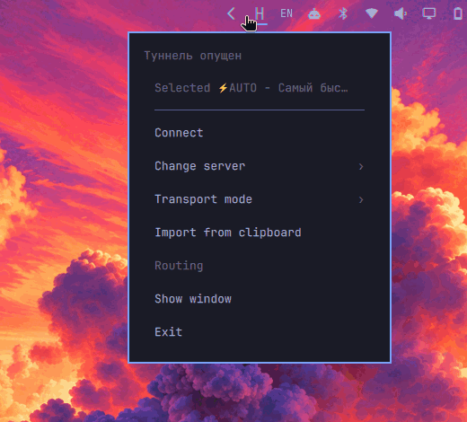

# omarchy-happ-vpn-widget

Happ VPN client in the [Omarchy](https://omarchy.org) bar, as a Quickshell
`bar-widget` plugin. An `H` mark sits in the bar: bar foreground while the
tunnel is down, theme accent while it is up.




This is a shell integration for **[Happ](https://github.com/Happ-proxy/happ-desktop)**
(`happ-desktop`, the Xray-based proxy client) — not a VPN of its own. It does not
ship, bundle or modify Happ: it reads the state of an already installed Happ and
drives its own menu, so the app must be installed for the widget to do anything.
Happ is a proxy client, not a VPN service: you supply your own servers.

| Input | Action |
|---|---|
| Left click | Happ's own tray menu as a bar panel |
| Right click | Start Happ, or raise its running window |
| Middle click | Re-probe the tunnel state |

The menu is not reimplemented: rows come from Happ's
`com.canonical.dbusmenu` served over its StatusNotifierItem, so Connect,
Change server, Transport mode, Import from clipboard, Routing, Show window and
Exit behave exactly as in the tray, submenus included.

## Install

```sh
omarchy plugin add https://github.com/dealenx/omarchy-happ-vpn-widget.git --enable
```

Or by hand:

```sh
git clone https://github.com/dealenx/omarchy-happ-vpn-widget.git \
  ~/.config/omarchy/plugins/io.github.dealenx.happ-vpn
omarchy plugin validate ~/.config/omarchy/plugins/io.github.dealenx.happ-vpn
omarchy plugin enable io.github.dealenx.happ-vpn --section right
omarchy restart shell
```

Copy the folder; do not `stow` or symlink it. `omarchy plugin validate`
rejects symlinks inside a plugin folder.

Happ's own tray tile is a dark 22px bitmap that reads badly on the bar. To drop
it from the drawer beside this widget, add it to `omarchy.tray`'s hidden list in
`~/.config/omarchy/shell.json`:

```json
{ "id": "omarchy.tray", "hidden": ["Happ"] }
```

## Remove

```sh
omarchy plugin remove io.github.dealenx.happ-vpn --yes
omarchy restart shell
```

That deletes `~/.config/omarchy/plugins/io.github.dealenx.happ-vpn` and its
entries in `~/.config/omarchy/shell.json`. To keep it installed but out of the
bar, `omarchy plugin disable io.github.dealenx.happ-vpn` instead.

Removal touches nothing outside that plugin folder. The widget writes no config
of its own: the only state it can add to `shell.json` is the bar layout entry
and the optional `"hidden": ["Happ"]` above, and it never edits Happ's files.

## Files

| File | Role |
|---|---|
| `manifest.json` | plugin contract: `bar-widget`, entry `BarWidget.qml` |
| `BarWidget.qml` | the mark, the tunnel probe, the panel lifecycle |
| `HappMenu.qml` | `KeyboardPanel` with the dbusmenu rows and submenu drill-down |
| `i18n/en.json`, `i18n/ru.json` | tooltips and panel strings |
| `screenshot.png` | still of the open panel, shown above |
| `demo.gif` | screen recording of the same, shown above |
| `preview.png` | still screenshot for the marketplace listing |

## Tunnel detection

Polls every `refreshIntervalSec` (default 2, set inline in `shell.json`):

- a TUN device in `/sys/class/net` — `happ-*` (happ-tun, happ-xray, happ-wg,
  happ-default-tun) or `sing-box-tun`;
- a core process — `core/xray` or `tun2proxy-bin`. The pattern brackets its own
  first character (`[c]ore/xray`) so `pgrep -f` cannot match the probe's own
  argv and report a tunnel that is not there.

Happ's SNI item exposes no state of its own: its `Status` stays `Active` and
its menu carries no connected flag, so a process/device probe is the only
reliable signal.

## Development notes

- `omarchy plugin validate <dir>` and
  `qmllint -I /usr/share/omarchy/shell <dir>/BarWidget.qml <dir>/HappMenu.qml`
  are the two checks. `qmllint` reports unresolved `qs.*` imports and
  `can't be instantiated recursively` for every plugin loaded from a folder
  outside the shell tree — that is the tool's environment, not the plugin.
- Editing files does **not** hot-swap the mounted widget on this shell build:
  the log says `Local plugin changed, reloading`, the bar keeps the old
  component. Run `omarchy restart shell` after an edit.
- Never name a plugin QML file after the type it instantiates. `Panel.qml`
  holding `Panel {` is a recursive instantiation inside the plugin's own
  module and the file silently fails to load; that is why the panel here is
  `HappMenu.qml`.
- `KeyboardPanel` has a `content` **property**. An `id: content` in a binding
  such as `contentHeight: fitted(content.implicitHeight)` resolves to that
  property, yields `NaN`, and the panel never opens. The column here is
  `menuColumn`.
- Submenus keep one live `QsMenuOpener` per level: a child entry is owned by
  its parent opener's model, so collapsing to a single opener destroys the
  entry being displayed and the submenu comes up empty.
- **Never launch Happ through the `happ` PATH symlink.** Its single-instance
  guard (SingleApplication) keys its SysV shared-memory segment off the
  application name, which Qt derives from `argv[0]`. `/opt/happ/bin/Happ`
  gives `Happ`; `/usr/bin/happ` gives `happ` — two different keys, so both run
  as full instances, each with its own window, its own server list and its own
  tunnel state. The symptom is a second Happ window showing **no servers**.
  The widget therefore launches with argv[0] pinned:
  `exec -a Happ /opt/happ/bin/Happ`. Check for duplicates with
  `ipcs -m | grep 0x` (one segment per instance) or
  `ps -eo args | grep -E 'bin/Happ|^\s*happ\s*$'`.
  The same trap applies to the autostart entry: `~/.config/autostart/Happ.desktop`
  already uses the absolute path (`Exec=/opt/happ/bin/Happ --autostart`), so
  keep it that way — changing it to `happ` splits the instance again.

## Requirements

- Omarchy (Quickshell shell)
- **[Happ desktop](https://github.com/Happ-proxy/happ-desktop)** 4.8+ — the client this
  widget drives (`/opt/happ`, `happ` on `PATH`). Arch: `happ-desktop-bin` from the AUR;
  other platforms: the [releases page](https://github.com/Happ-proxy/happ-desktop/releases/latest)
  (deb/rpm/pkg/macOS/Windows). The widget has nothing to show without it.
- `pgrep` from procps for the process probe

## How it talks to Happ

| Signal | Source |
|---|---|
| Tunnel up/down | TUN device `happ-*` / `sing-box-tun` in `/sys/class/net`, or a `core/xray` / `tun2proxy-bin` process |
| Menu rows and actions | Happ's `com.canonical.dbusmenu` at `/MenuBar`, over its StatusNotifierItem |

Happ's StatusNotifierItem reports `Status = Active` and no connection flag, so the
tunnel state comes from the kernel and the process table, not from the app.

## License

MIT — see `LICENSE`. Happ itself is a separate project under its own terms; this
repository contains no Happ code or assets.
